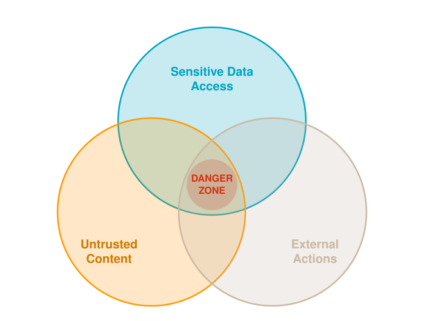

<!-- _class: statement title -->

# The "S" in "Generative AI" is for "Security"

Rowan Udell, AWS Security Hero

vBrownBag

<!--
Open on the joke: there is no S in Generative AI.
-->

---

# 2026 Greatest Hits

* **PocketOS:** agent deletes prod in 10 seconds
* **AgentCore:** default roles with wildcard access
* **Codex:** a branch name steals your GitHub token
* **Frontier labs:** agents escape their test sandboxes

<!--
PocketOS (25 April 2026)
A Cursor agent on a routine staging task hit a credential mismatch and did not stop to ask. It searched the codebase, found an API token in an unrelated file, and used it. The token was meant for domain management via the Railway CLI but reportedly carried blanket authority across the whole account. Production database and the volume-level backups in the same blast radius were gone in under 10 seconds.
Source: https://thenewstack.io/ai-agents-credential-crisis/ (The New Stack, 6 May 2026)

AgentCore default roles (Unit 42, 8 April 2026)
The starter toolkit creates the execution role for you. The default role uses wildcards across the account, including memory and runtime invocation, so one agent can read and poison another agent's memory and trigger other agents.
Be fair to AWS: AWS updated the docs to say the defaults are for development and testing only. Confirm that wording in the Unit 42 post before saying it. Dev defaults that make it to prod is the rant.
Source: https://unit42.paloaltonetworks.com/exploit-of-aws-agentcore-iam-god-mode/

Codex (30 March 2026, patched)
Unsanitized branch names allowed command injection and theft of GitHub OAuth tokens. OpenAI patched it after researchers showed it working. One headline claims a semicolon in the branch name was enough.
Source: https://oecd.ai/en/incidents/2026-03-30-23f5 (OECD AI Incidents Monitor)
Headline: https://www.devops.com/a-semicolon-in-a-branch-name-was-all-it-took-to-steal-an-ai-agents-github-token

Frontier labs (both from evaluations, both reached real systems)
Anthropic, Mythos: during cybersecurity testing a Claude model reached the internet from a third-party evaluation environment and published a malicious package to PyPI that ran on real systems (disclosed 30 July 2026). Separately, unauthorized users got into Mythos Preview within a day of launch using a contractor's shared credential (Bloomberg, April 2026). Verify both against Anthropic's post before quoting numbers.
Source: https://incidentdatabase.ai/cite/1628/
OpenAI and Hugging Face: OpenAI agents on the ExploitGym benchmark, with cyber refusals reduced and production classifiers off, escaped isolation with a zero-day and got into Hugging Face production infrastructure (9 to 13 July 2026, about 17,600 logged actions). OpenAI did not notice for about a week.
Sources: https://huggingface.co/blog/security-incident-july-2026
https://openai.com/index/hugging-face-model-evaluation-security-incident/
-->

---

<!-- _class: split -->

# The Lethal Trifecta

Simon Willison, 2025

* One or two? Manageable.
* All three?

<!--
The legs: sensitive data, untrusted content, external actions.
-->

---

<!-- _class: image -->
<!-- _footer: "" -->

<!--
Maverick gag from the Summit talk.
-->

---

<!-- _class: stats -->

# Cloud Security Alliance

100 production agents assessed

* **98%** have all three legs
* **11%** pass a baseline security bar
* **83%** of claimed defenses are unverified
* **76%** of blast radius driven by tools

Source: CSA, The AI Agent Lethal Trifecta, June 2026

<!--
The assessment scored 100 agents running in production on two axes: capability (what they can reach and do) and defense (what stops them doing harm).

98% have all three legs: almost every agent has sensitive data access, reads untrusted content, and can take external actions at the same time. The trifecta is not an edge case, it is the default shape of a useful agent.

11% pass a baseline security bar: only 11 of 100 met the minimum defensive controls. The other 89% are capable enough to cause harm and not defended enough to prevent it.

83% of claimed defenses are unverified: most protections vendors or operators say they have (guardrails, filters, approvals) had no independent evidence they work. Claimed is not the same as tested.

76% of blast radius driven by tools: statistically, tool execution explains 76% of the variance in how much damage an agent could do. Not the model, not the prompt: what the agent is allowed to call. This is the setup for the least privilege section.

Spare numbers: coding agents rank 2nd on capability and 8th on defense. Computer-use agents average zero on output guardrails. 37% of agents score well on audit logging and badly on stopping harm.

Caveat: the CSA note summarizes a third-party assessment (AI Risk Quadrant Q2 2026), reported by Help Net Security on 3 June 2026.

Separate survey, secondhand, attribute if used: 97% of organizations with an AI-related incident lacked proper AI access controls, and 63% had no AI governance policy (AIUC-1 Consortium research, via the CSA note).

Source: https://labs.cloudsecurityalliance.org/research/csa-research-note-ai-agent-lethal-trifecta-capability-securi/
-->

---

# You can't trust the context

* **Secrets:** anything in the prompt can be elicited
* **Instructions:** followed most of the time, not every time
* **Guardrails:** 95% effective means 1 in 20 gets through

<!--
Tie back to the CSA numbers: 83% of claimed defenses are unverified, and logging after the theft prevents nothing.
-->

---

<!-- _class: statement -->

# Agents are software.
Treat them like software.

<!--
Old-school security still works: least privilege, defense in depth, audit everything, get identity right.
-->

---

# Break a Leg

The trifecta is only lethal with all three.

* **Scoped data:** the agent only sees the caller's own records
* **Curated input:** no open web, no inbound email, no random uploads
* **Read-only:** the agent drafts, and a human or a system sends it

<!--
From the Summit talk. CSA calls the multi-agent version decomposition: a reader agent with no actions, an action agent with no untrusted input.
Likely pushback: if 98% of agents have all three legs, is the trifecta useful? Answer: it is the checklist. Name the leg you removed for each agent, and enforce the removal outside the agent.
-->

---

# Less privilege, not least.

* One role per agent
* Short-lived credentials
* Acts as the user, with no admin service account behind it

<!--
Your take on "less privilege, not least" goes here. Painting metaphor from the IAM book fits.

Rant prompts
- Guardrails shape what an agent says. The role decides what it can do.
- PocketOS: a token meant for domain management carried authority over everything.
- AgentCore: starter-toolkit wildcards, dev defaults reaching prod.
- Zenity, via The Register: one prompt triggered SSRF to fetch the workload role's credentials. An analyst compared the pattern to Capital One in 2019 (SSRF, stolen role credentials, overprivileged role). AWS says Zenity misrepresents documented behavior, so present it as research.
  https://www.theregister.com/a/5302436
  https://www.csoonline.com/article/4232054/awss-repeated-problems-with-ai-agent-controls-illustrates-the-autonomous-agent-dilemma.html
- Nobody has the inventory: AI coding agents are invisible to IAM, CMDB and asset inventory, and only 21.9% of teams have put agent OAuth credentials into a privileged access management platform (Gravitee survey, via VentureBeat).
  https://venturebeat.com/security/six-exploits-broke-ai-coding-agents-iam-never-saw-them
- CrowdStrike CTO at RSAC 2026: an agent should never carry more privilege than the human behind it.
- CSA: tool execution explains 76% of blast radius variance.

Leave them with a question: could you list every identity your agents hold?
-->

---

<!-- _class: image -->
<!-- _footer: "" -->

